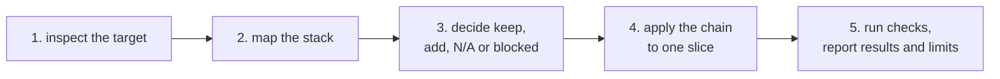

# Adoption instructions

Apply the cohesive stack to an existing repository without discarding sound equivalents.

For the exercised local consumer path and its supported/manual boundaries, follow [WALKTHROUGH.md](WALKTHROUGH.md). It starts with inspection, explicit planning, reviewed diff and confirmation for an existing supported literal gate, followed by separately authorised native checks. Historical manual transfer and optional scaffolding are separate alternatives; none certifies a complete consumer setup.

These instructions govern the target repository. The playbook source repository's root `AGENTS.md` and verifier are maintenance tools for the playbook itself.

> **Setup checks first:** if the target cannot reliably build, run and check changes, start with [`quality-gate/`](quality-gate/README.md). `doctor` audits configuration. Preserve existing gates and use explicit planning/reviewed application or manual native recipes. Optional `install` adds missing scaffolding only for matched adapters; it is not a remedy for every reported gap. Neither command certifies readiness. Run the target's real checks, then assess each change against its ticket and brief. See the [checklist](checklists/quality-gate.md).

> **Diagnostics hosting is a user choice:** default to local GlitchTip with MCP; cloud requires an explicit choice. [DIAGNOSTICS.md](DIAGNOSTICS.md) defines the boundary. Deployment is not yet implemented or activated. Keep the Python 3.9+ adoption core dependency-free and native failure/recovery checks independent.

## Standards and imperfect targets

Define the template by target-independent quality outcomes: useful tests, failures
that stop the gate, honest evidence, environment isolation and checks appropriate
to the product. Reference projects, including Toybox, supply examples and failure
cases. Their directory layouts, tools, version pins and historical workarounds do
not become template requirements merely because they exist.

For adoption, compare the target with those outcomes. Keep sound equivalents,
adapt or explicitly replace unsound checks, add missing capabilities, and leave
unresolved prerequisites visible. Preserve history and useful behaviour without
preserving a known defect as a permanent requirement. A partial adoption must
state which quality gaps remain; it does not lower the target standard or imply
that an unrun check passed.

The current reviewed literal-gate editor only appends missing commands. Repairing
or replacing an existing bad command requires an explicitly reviewed manual
native-owner change; appending a good command after a failing old one is not a
repair. Test both a clean starter and imperfect targets against the same quality
outcomes, rather than judging success by resemblance to a reference repository.

## The adoption path



## Inputs

You need:

- the target repository and authorised change;
- its product, technical, security, and release authorities;
- authority to inspect files and run existing checks;
- approval under the target repository's rules before adding dependencies, services, credentials, or release actions.

## 1. Inspect the target

Start from its normal install, test, build and dev commands. Check what those commands actually execute before adding tooling. Keep useful application and isolation repairs; do not make a historical assurance ledger or custom installer a prerequisite for ordinary development. [CFA and Kept field lessons](research/field-lessons.md) explain the boundary.

Read:

- repository instructions and product documentation;
- build, test, browser, audit, and release commands;
- schemas, interfaces, and affected source code;
- security, privacy, legal, accessibility, and operational policies;
- monitoring and recovery paths;
- current working-tree state and local changes.

## 2. Map the stack

Create a short adoption map:

| Role | Existing tool or practice | Keep, add, N/A, blocked, or not run | Reason |
|---|---|---|---|
| Project Brief | `<value>` | `<decision>` | `<authority or gap>` |
| BDD discovery | `<value>` | `<decision>` | `<authority or gap>` |
| TDD and fast tests | `<value>` | `<decision>` | `<authority or gap>` |
| Browser journeys | `<value>` | `<decision>` | `<authority or gap>` |
| Bounded UX review | `<value>` | `<decision>` | `<authority or gap>` |
| Error capture and recovery | `<value>` | `<decision>` | `<authority or gap>` |
| Supply-chain checks | `<value>` | `<decision>` | `<authority or gap>` |
| Candidate evidence and review | `<value>` | `<decision>` | `<authority or gap>` |

Use the defaults in `STACK.md` for missing roles. Keep sound equivalents. Mark a role N/A only when the product or authorised change genuinely does not exercise it. Missing authorization, unavailable tooling, or an unexecuted required role is blocked or not run. Preserve every role and its disposition in the authoritative adoption map.

Stack-role disposition remains manual. The [consumer capability map and mixed-stack example](CONSUMER-ADOPTION.md#consumer-capability-state-map) distinguish existing heuristics from proposed component mapping and native-command discovery. Current `doctor` uses file-derived inspection without version executables, preserves target files and labels versions unprobed and commands as unverified defaults. It now reports unexecuted package script declarations from root `package.json` and the single frontend selected by the existing Vite detector, with source path, script name, literal command and owning working directory. An absent root manifest is informational and root package-script discovery is not applicable unless Vite detection already identified it as expected. Missing expected manifests, present unreadable or malformed manifests and invalid script values remain unresolved; absent scripts are allowed. This bounded reporting does not select a package manager or verify commands. Installation still probes available tool versions for pins; its generation behaviour is unchanged, and inspection does not establish readiness.

The same manifests also expose optional top-level `packageManager` as exact,
JSON-quoted declared/unverified intent with source and owning directory. Absent or
unusable optional declarations add no gaps. Root/Vite values are not reconciled;
legacy adapters/scaffold defaults are not chosen from them. No format/pin/hash,
installation, active-manager or trust claim follows. Use the inspected explicit
native plan; see the [metadata contract](quality-gate/README.md#optional-package-manager-declaration-evidence).

Audit/doctor also reports immediate-child Go marker candidates with exact owning
directory and marker path as unverified file presence. Root Go adapters remain
root-only. The [bounded scope and exclusions](quality-gate/README.md#immediate-child-go-marker-evidence)
leave deeper, linked, hidden and dependency/build layouts uninspected; discovery
errors remain unknown, independently of existing gap arithmetic. This evidence
does not parse modules or choose commands, runners, entrypoints or versions.
Inspect each candidate's documented commands before supplying an explicit plan.

After inspection, preview explicit commands with the read-only planner.

```sh
python3 quality-gate/adopt.py plan /path/to/project \
  --command test backend 'go test ./...' \
  --command test frontend 'npm run ui:check' \
  --command build frontend 'npm run bundle:ui'
```

A person and an LLM use identical arguments. Provenance is explicitly supplied/unverified,
and repeated task commands retain their order. The plan accepts existing inside-target
relative directories beyond detection coverage, displays proposed adoption-map rows,
remaining manual roles/tasks and paste-ready entries for the generated `COMMANDS` dict.
Partial selection is supported. Invalid selection or no selection exits 2 without a
snippet. See the [validation and manual-application contract](quality-gate/README.md#explicit-command-plan).
For an existing supported literal gate, use the
[reviewed application option](quality-gate/README.md#reviewed-gate-application-contract)
to review a display-only line-oriented diff with
`plan TARGET --preview-gate --command ...`. Quotes and hunk lines are directly
readable; backslashes, controls and non-ASCII use visible escapes. Do not paste
the display as source; the retained exact JSON block is authoritative for byte
copying after decoding. Apply with
`plan TARGET --apply-gate FINGERPRINT --command ...` using the preview value and
identical selections. This candidate appends missing commands, preserves existing
checks and refuses stale bytes. Changing applications retain original bytes/mode
in content-derived backups without manual relocation; exact matching regular
nonsymlink backups may be reused, while mismatches and a retained fixed temporary
path refuse. Historical backups are never automatically removed. See the linked
contract for naming and manual recovery. Unsuitable defaults require an explicit manual
decision. For manual transfer instead, merge every required check before replacing only selected lists; keep Makefile recipes under their existing owner. Update the authoritative adoption map and review the resulting diff. Gate execution requires separate authority. Broader role mapping
remains manual. This preview executes no selected command and supplies no readiness
certificate.

## 3. Establish the context

Reuse existing documents where they contain the required information. Add only missing information:

1. target-repository `AGENTS.md` with real paths, commands, boundaries, approvals, and a link to the authoritative adoption map;
2. Project Brief with requirements, constraints, acceptance conditions, and evidence links;
3. BDD rules, examples, and questions for the representative slice;
4. verification and validation record for the evaluated change.

The templates may be combined, renamed, or embedded in existing project documentation.

## 4. Implement one representative slice

Follow this chain:

1. identify the affected requirement and acceptance condition;
2. map rules, examples, and unresolved questions;
3. resolve consequential ambiguity or record the responsible assumption;
4. establish meaningful RED for changed behaviour, or a green characterisation baseline for behaviour-preserving work;
5. implement the smallest coherent change and reach GREEN;
6. refactor while relevant checks remain green;
7. run affected unit, integration, and contract checks;
8. run the Playwright journey or the target's equivalent browser check;
9. run bounded Midscene review when the slice contains a useful visual question;
10. exercise minimal diagnostic capture and independently check recovery when operational errors are in scope;
11. run the target's dependency and supply-chain checks;
12. bind each final report to the evaluated revision and relevant environment, keeping RED tied to its earlier revision;
13. complete the target repository's independent review and release process.

A failed deterministic check remains a failure. Midscene findings are advisory until the project validates that evaluation setup.

Keep independent review bounded. Repair concrete blockers and rerun affected evidence without starting an open-ended review programme.

## 5. Report the result

Leave:

- the adoption stack map;
- affected requirements and scenarios;
- changed files;
- procedures and commands run;
- observed results and evidence locations;
- Midscene validation status and findings where used;
- Midscene validation-record path, agreement criteria, result, and approver when validated status is claimed;
- diagnostic isolation, field allowlist, opt-out, data, recovery and cleanup results where used;
- supply-chain results and accepted exceptions;
- evidence limits, unresolved risks, and responsible owners.

## Ready-to-use request

```text
Apply the cohesive stack from this playbook to the target repository.
Read STACK.md, then inspect the target's own instructions and tools.
Map every stack role to an existing equivalent, a justified default, N/A,
blocked, or not run. Give the reason for every disposition.
Keep sound equivalents and add only missing roles within current authority.
Apply Project Brief, BDD, TDD, deterministic checks, Playwright, bounded Midscene,
minimal diagnostics and recovery, supply-chain checks, and revision-bound evidence to one
representative slice. Run the target repository's required checks and report
results, evidence limits, substitutions, and unresolved risks.
```
