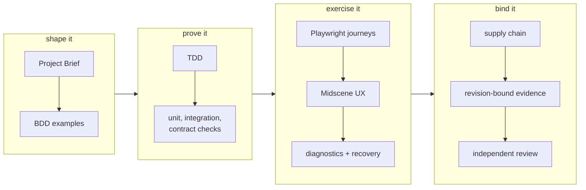
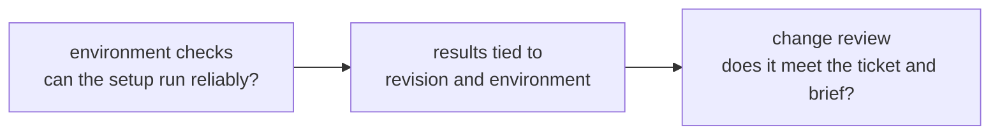
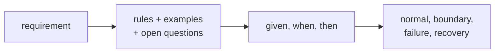
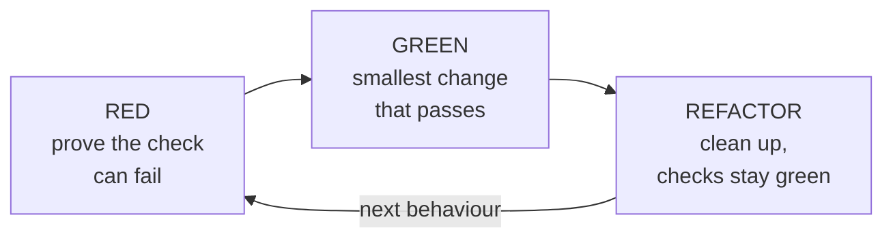
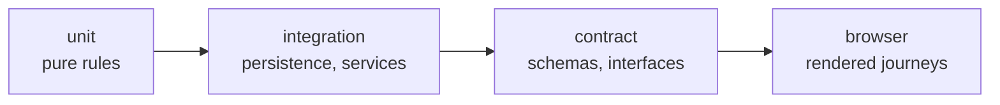
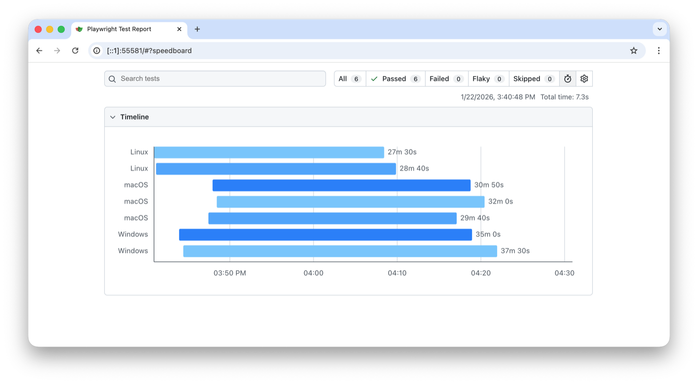
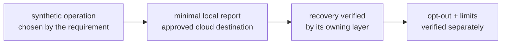
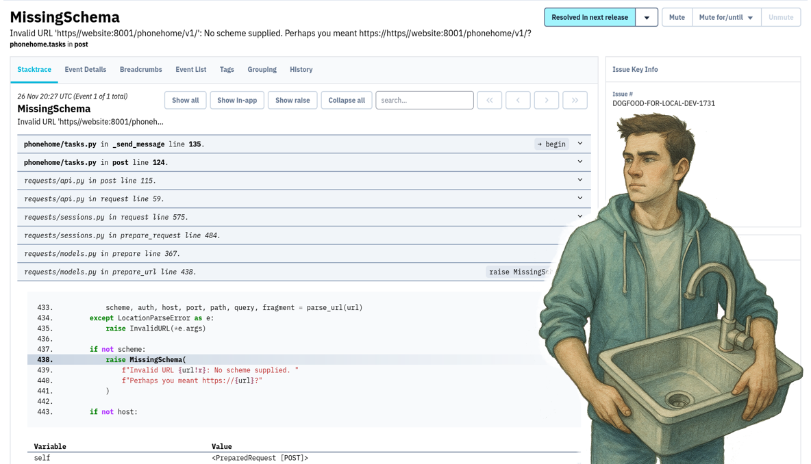
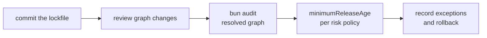

# James's opinionated LLM development framework

A playbook for developers and coding agents: turn a project brief into small, testable changes, then review the evidence before calling them done.

## Two separate decisions

- **Is the environment ready?** Can this project reliably install dependencies, build, run and execute its checks in the stated environment? A reliable test setup does not guarantee that the tests cover the requirements.
- **Does the change meet the request?** Does this revision satisfy the ticket's acceptance criteria and respect the project brief? Passing the existing suite helps, but it does not prove the ticket is done.

The **brief** defines the purpose and constraints. The **ticket** defines the bounded change. Tests, user journeys and review provide evidence for accepting that change.

### Accepting an incoming change

The subject is **one exact revision**, not the environment or the project as a whole. Review it against three separate questions:

| Check | Question | Required evidence |
| --- | --- | --- |
| **Ticket compliance** | Does it deliver every acceptance criterion, without unapproved scope? | Each criterion maps to an observable result from the candidate and a test, inspection or demonstration that checks it. |
| **Brief alignment** | Does it respect the intended users, constraints and non-goals? | Review affected behaviour against the relevant brief clauses, including conflicts and relevant regressions. |
| **Goal contribution** | Does the delivered behaviour support the intended user outcome? | State the expected contribution and demonstrate the relevant user task. If the real outcome needs later user or production measurement, name that measure and leave the outcome unproven. |

**Example:** the goal is to avoid repeated setup; the brief says preferences persist locally without an account; the ticket asks to retain the selected language after restart. Check that the language survives restart, that the change neither requires an account nor sends preferences elsewhere, and that the user can resume without selecting the language again. This supports the intended task; it does not establish a measured reduction in real users' effort.

Use [`templates/VERIFICATION.md`](templates/VERIFICATION.md) to connect **criterion → check → observed result → exact revision**. Mark each required claim **supported**, **failed** or **unproven**. Missing evidence is unproven, not a pass. A ticket that conflicts with the brief needs the responsible owner's decision, not a silent reinterpretation by the agent.

Keep the conclusions separate: **environment ready**, **change accepted**, and **user outcome demonstrated** are different claims. Passing the existing suite or verifying evidence provenance cannot replace this comparison. Accept only when required claims are supported or explicitly changed or excepted by the responsible authority; disclose any outcome measurement that remains deferred.

## Start here

Start with the target repository's instructions and **one authorised task**.

Use the [consumer walkthrough](WALKTHROUGH.md) for the concise operator path: inspect, supply an explicit plan, apply reviewed commands, run the native test and report the scoped result.

- **Prepare the environment:** use [`quality-gate/`](quality-gate/README.md). Its `doctor` reports recognised configuration; it does not certify readiness. `install` creates missing scaffolding and regenerates `GATE.md` with remaining steps. The tool requires Python 3.9+, installation requires Git, and generated tasks require the project's native toolchains. Prefer no script? [Follow the manual procedure](quality-gate/README.md#do-it-by-hand).
- **Apply the workflow:** follow [`ADOPT.md`](ADOPT.md), using [`STACK.md`](STACK.md) to map the roles to existing tools. Keep sound equivalents. Add a tool only when the task needs its role and installation is authorised.

For a coding agent:

```text
Read https://github.com/jamesdwilson/james-opinionated-llm-development-framework
Follow ADOPT.md and the target repository's own instructions.
Inspect its current tools and the authorised task. Map the applicable roles
using STACK.md; keep sound equivalents. Work on one bounded change.
Run the required checks and report results, evidence limits and unresolved gaps.
```

**Current status:** the playbook and Python adoption scaffolding exist. The [walkthrough](WALKTHROUGH.md) documents the verified local synthetic Python path: scaffolding, manual command application and native test success/failure. A reviewed-application capability adds opt-in diff preview and fingerprint-confirmed
updates to an existing supported literal `gate.py`. Bounded independent source review
and a blind local consumer attempt passed, including preservation and repeat use.
A content-derived backup successor now addresses the observed manual relocation
between changing applications. Independent review passed, and a fresh blind consumer
completed three changing applications without moving any recovery history. This is bounded adoption evidence, not complete environment readiness. The [adoption-kit evidence](quality-gate/README.md) covers limited synthetic-fixture checks, not a complete consumer installation. Toybox has bounded independent acceptance for owned dependencies, a cold-copy installation and a no-recording journey, not automatic framework adoption. Kept's local acceptance is retained-record attribution because its referenced final review and raw evidence are unavailable in the current corpus. CFA's later setup remains partial. See [field evidence and limits](research/field-lessons.md) and the [supported/manual scope and proposed consumer capability map](CONSUMER-ADOPTION.md#consumer-capability-state-map).

## The workflow

Our chosen sequence is **brief → examples → TDD → complementary checks → revision-bound evidence → independent review**. Research supports parts of it, not the complete package; see [the evidence and its limits](#what-the-research-does-and-does-not-prove).

The diagram groups the roles, not a requirement to install every tool. Select checks for the task and record what applies, what ran and what remains unproven.



Keep verification bite-sized: one behaviour or claim per task. Run broader checks at the change's acceptance boundary. A later check cannot excuse a failed requirement.

<a id="the-quality-gate-a-ready-environment"></a>


## What gets the final say

The [CFA and Kept field lessons](research/field-lessons.md) explain our practical defaults: native commands, real worker isolation, production-built journeys, safe restart and one bounded review. These are project experience, not universal research findings.

Each decision should follow the source that actually owns it:

- stakeholders and product requirements for intended outcomes;
- laws, standards, policies, and contracts for mandatory constraints;
- schemas, interfaces, source code, and existing tests for current technical contracts;
- verification and validation evidence for the claims those methods can actually answer;
- empirical research within its studied population, tasks, measures, and limitations;
- official documentation for a tool's supported capabilities.

Treat the stack as a useful default, not a rule you have to follow. It does not outrank the law, a product decision, or a proven project-specific constraint.

## Suggested stack

| Role | Purpose |
| --- | --- |
| [Project Brief](#stack-project-brief) | Define users, outcomes, constraints and acceptance conditions. |
| [BDD and Example Mapping](#stack-bdd) | Clarify rules, examples and open questions before implementation. |
| [TDD](#stack-tdd) | Demonstrate missing behaviour, implement it, then refactor. |
| [Deterministic tests](#stack-deterministic-tests) | Check rules, boundaries and contracts reproducibly. |
| [Bun](#stack-bun) | Default JavaScript runtime, package manager and test runner. |
| [Playwright](#stack-playwright) | Exercise user-visible behaviour in a browser. |
| [Midscene](#stack-midscene) | Add bounded, advisory checks of interface clarity. |
| [Diagnostics and recovery](#stack-diagnostics) | GlitchTip + MCP: local by default, cloud by user choice; rollout not activated. |
| [Supply-chain checks](#stack-supply-chain) | Inspect dependencies and available advisories. |
| [Revision-bound evidence](#stack-revision-evidence) | Identify exactly what was tested and under which conditions. |
| [Independent review](#stack-independent-review) | Challenge coverage, results and conclusions. |

## How each piece works

Each section explains the role, its evidence boundary and the supporting sources.

<a id="stack-project-brief"></a>
### 1. Project Brief

A Project Brief gives the LLM a map before asking it to drive. It says who the product is for, what success looks like, what is out of scope, and what evidence counts. That helps a fluent agent avoid building a polished answer to the wrong question.

**Under the hood:** capture purpose, outcomes, stakeholders, context, scope, requirements, quality attributes, constraints, assumptions, risks, decisions, acceptance conditions, and evidence links. ISO/IEC/IEEE 29148 covers requirements-engineering processes and information items. [[1]](https://www.iso.org/standard/72089.html) NASA's Systems Engineering Handbook covers stakeholder expectations, operational concepts, requirements, verification, and validation. [[2]](https://www.nasa.gov/wp-content/uploads/2018/09/nasa_systems_engineering_handbook_0.pdf) ISO/IEC 25010 supplies a product-quality model. [[3]](https://www.iso.org/standard/78176.html) Goal-oriented requirements engineering connects goals, requirements, and rationale. [[4]](https://webperso.info.ucl.ac.be/~avl/files/RE01.pdf)

Use [`templates/PROJECT_BRIEF.md`](templates/PROJECT_BRIEF.md).

<a id="stack-bdd"></a>
### 2. BDD and Example Mapping

BDD turns fuzzy language into examples people can actually discuss. "Make checkout simple" is vague. A few concrete examples of what happens, what can go wrong, and how the user recovers give the LLM something solid to build.

**Under the hood:**



Use Example Mapping for discovery. [[13]](https://cucumber.io/docs/bdd/example-mapping/) NASA supports operational scenarios as part of understanding expected use. [[2]](https://www.nasa.gov/wp-content/uploads/2018/09/nasa_systems_engineering_handbook_0.pdf) TiCoder and ClarifyGPT provide empirical support for concrete tests and targeted clarification within their studied tasks. [[7]](https://arxiv.org/abs/2404.10100) [[8]](https://arxiv.org/abs/2310.10996)

Use [`templates/JOURNEYS.md`](templates/JOURNEYS.md).

<a id="stack-tdd"></a>
### 3. TDD: RED, GREEN, REFACTOR

TDD makes the model show the problem before it fixes it. RED proves the check can catch the missing or broken behaviour. GREEN shows that the smallest repair satisfies the relevant checks. REFACTOR cleans things up without losing that evidence.



**Under the hood:** write or identify a meaningful failing check for the behaviour being changed. Make the smallest coherent change that satisfies it. Clean up only while the relevant checks stay green. If behaviour should not change, start from a verified green characterisation instead of manufacturing a failure.

Across 20 diverse web applications, TDDev reports accuracy gains of 15.5 to 23.7 percentage points with sufficiently capable backbones; a stronger tester restored positive gains for a lower-capability backbone. [[15]](https://arxiv.org/abs/2605.17242) TENET reports benefits from representative developer-written tests, retrieval guided by tests, and iterative failure analysis. [[12]](https://arxiv.org/abs/2509.24148) TestSuiteBench shows that coding agents still struggle to create strong repository-level test suites from specifications. [[11]](https://arxiv.org/abs/2610.13065)

Full RED, GREEN, REFACTOR is the chosen operating discipline here. The research supports test-guided repair in the settings it studied. It does not prove that the complete sequence is universally best.

<a id="stack-deterministic-tests"></a>
### 4. Deterministic tests

Deterministic tests check observable behaviour under controlled inputs and conditions. For example, a persistence test can check whether a saved preference survives restart. A reproducible pass establishes only what its assertions actually cover.

**Under the hood:** use the simplest test that can answer the question reliably:



Program structure can also reduce ambiguity for coding agents. Skeleton Coding reports benefits from structural specifications in its evaluated settings. [[14]](https://arxiv.org/abs/2610.38214)

The exact split is a stack convention. Keep an existing test layer when it already answers the same question cleanly.

<a id="stack-bun"></a>
### 5. Bun

Bun earns its place by replacing a small pile of JavaScript tooling with one fast tool. It can run the code, install packages, and run tests, which means less setup and fewer version seams for people and LLMs to keep straight.

**Under the hood:** Bun's test runner is designed to feel familiar to Jest users. [[18]](https://bun.com/docs/test) Bun's own benchmark reports `bun install` as up to 25 times faster than npm. Bun also limits dependency lifecycle scripts to trusted packages, including a built-in allowlist. Those are useful defaults, not a promise that every Bun application will be faster or safer than every Node application. [[27]](https://bun.com/docs/pm/cli/install) [[28]](https://bun.com/docs/pm/lifecycle)

If you're a big fan of Node or do not want to use Bun, don't worry about it. Keep Node when it is working well. Bun's package manager can also be used in an existing Node project, so trying it does not have to be an all-or-nothing migration. [[27]](https://bun.com/docs/pm/cli/install)

<a id="stack-playwright"></a>
### 6. Playwright

Playwright closes the awkward gap between "the function passed" and "the app works." It opens the real page, clicks the real controls, reloads, and checks what is actually visible to expose user-facing failures lower-level tests may miss.



*The trace viewer: every action on a timeline, with before/after snapshots and the exact click position. Image: Playwright documentation.*

**Under the hood:** Playwright owns critical rendered journeys including visible state, interaction, permissions, reloads, client-side recovery, and user-observable persistence. It recommends isolated tests, user-facing assertions, resilient locators, and web-first waiting. [[16]](https://playwright.dev/docs/best-practices) Its planner, generator, and healer agents can assist test creation while executable assertions remain the behavioural evidence. [[17]](https://playwright.dev/docs/test-agents)

<a id="stack-midscene"></a>
### 7. Midscene

Midscene adds AI-assisted interaction and visual assertions through Playwright. Use it to flag possible interface problems, such as an unclear next step, rather than treating its judgement as proof of usability. [[19]](https://midscenejs.com/integrate-with-playwright.html)

Use it for narrow questions such as:

- Is the required choice understandable?
- Is the next action visually apparent?
- Does the completed state explain what happened?
- Is the recovery path visible after the exercised failure?


*The playground: describe an action in words, watch it drive the page visually. Image: Midscene documentation.*

**Under the hood:** Midscene is advisory by default. It cannot overrule a failed deterministic check. Count its output as release evidence only after the project has validated the model, prompt, fixtures, and agreement with responsible human judgement.

<a id="stack-bugsink"></a>
<a id="stack-diagnostics"></a>
### 8. Minimal diagnostics and recovery

**Selected direction: GlitchTip with MCP, local by default.** Users may explicitly choose cloud hosting. Never fall back to cloud silently. [DIAGNOSTICS.md](DIAGNOSTICS.md) records the policy and integration boundaries; no service or upload is activated by adopting this document. Native tests still prove failure and recovery independently.

**Collection must be obvious and easy to stop:** show the fields and destination before collection; the product must honour both `OTEL_SDK_DISABLED=true` and `DO_NOT_TRACK=1`, including non-OTel collection paths. No raw logs, source code, prompts or stable device identifiers by default. Activation requires appropriate consent and verified credentials, access and limits for the chosen deployment. [DIAGNOSTICS.md](DIAGNOSTICS.md) separates current policy from historical provider assumptions. This playbook does not collect or upload anything merely by being installed.



<details>
<summary>Historical Bugsink illustration, preserved rather than deleted</summary>

Bugsink was the earlier error-tracking default. Existing integrations and evidence are not automatically migrated. Its documentation establishes its historical role, not acceptance of the new diagnostics path. [[20]](https://www.bugsink.com/docs/)



*Historical illustration. Image: bugsink.com.*

</details>

<a id="stack-supply-chain"></a>
### 9. Supply-chain checks

Supply-chain checks answer the question hidden behind "it installed": what did we actually install? They make dependency changes visible, check known advisories, and can keep very new package releases out until they have had time to settle.

**Under the hood:** keep dependency changes boring and reversible. For Bun projects:



Bun documents its audit command and release-age control. [[21]](https://bun.com/docs/pm/cli/audit) [[22]](https://bun.com/docs/runtime/bunfig) [[27]](https://bun.com/docs/pm/cli/install) NIST's Secure Software Development Framework supplies broader secure-development guidance. [[23]](https://nvlpubs.nist.gov/nistpubs/SpecialPublications/NIST.SP.800-218.pdf)

The release-age filter applies during new resolution. It does not go back and judge packages already present in `bun.lock`. An audit may also skip a scoped registry that has no advisory endpoint without changing the exit code. Record both conditions. This playbook does not set one universal quarantine period; the responsible security authority owns that choice.

<a id="stack-revision-evidence"></a>
### 10. Evidence tied to the exact build

Evidence tied to the build gets rid of the vague "it passed on my machine yesterday" claim. Every test result points to the exact commit, build, commands, and environment that produced it.

**Under the hood:** record the project-native revision identity, exact commands or procedures, observed results, report locations, relevant environment facts, and evidence limits. Use a clean commit, release artefact, or another identity the project already trusts. SLSA provenance provides a model for connecting an artefact to its build context. [[24]](https://slsa.dev/spec/v1.2/provenance) A controlled traceability experiment found maintenance benefits for its participants and projects. [[5]](https://www.patrickmaeder.de/pdf/ICSM2012_maeder_egyed_AssessingEffectOfRequirementsTraceability.pdf) An industrial multi-case study documents both the use and communication limits of tests as requirements. [[6]](https://doi.org/10.1016/j.infsof.2016.03.008)

Use [`templates/VERIFICATION.md`](templates/VERIFICATION.md).

<a id="stack-independent-review"></a>
### 11. Fresh eyes before done

Fresh eyes matter because the builder already knows what they intended. A separate reviewer sees only what the exact revision and its evidence actually prove, which makes weak tests, stale evidence, missing requirements, and overconfident conclusions easier to spot.

**Under the hood:** record what changed, what ran, what passed, what remains uncertain, and who owns the next decision. OpenAI and Anthropic engineering reports emphasise repository legibility, mechanical checks, durable progress, and useful handoffs in long-running agent work. [[25]](https://openai.com/index/harness-engineering) [[26]](https://www.anthropic.com/engineering/effective-harnesses-for-long-running-agents)

The project can choose the reviewer and handoff format. The important bit is that the final challenge is genuinely independent of the person or agent that made the change.

## Repository instructions

Keep `AGENTS.md` short enough that an agent can actually use it. Connect the stack to the target repository's real paths, commands, boundaries, and evidence. One study found generated context files could reduce success and increase inference cost in several evaluated settings; its aggregate success differences were not statistically significant. [[9]](https://arxiv.org/abs/2602.11988) Another associated existing `AGENTS.md` files with lower median runtime and output-token use while leaving comprehensive semantic-correctness evaluation open. [[10]](https://arxiv.org/abs/2601.20404)

Neither study validates this template or tells us the perfect file length. [`templates/AGENTS.md`](templates/AGENTS.md) is simply the format chosen here.

<a id="adoption-rule"></a>
## Less is more

Keep sound existing tools and record their roles in the stack map. Add only what closes a demonstrated gap. This is a design choice, not a guarantee that fewer dependencies or shorter instructions always produce better results.

## What the research does and does not prove

**Clarify intent before generating code.** TiCoder describes “guided intent clarification (i.e., partial formalization) through tests”. Its study with 15 programmers found better evaluation of generated code; its separate benchmark used idealized user feedback rather than ordinary project work. [[7]](https://arxiv.org/abs/2404.10100)

**Use tests to guide implementation.** TENET describes “defining tests as executable specifications” and reports improvements on RepoCod and RepoEval with representative tests, retrieval and iterative failure analysis. That supports test-guided generation in those settings, not a universal verdict on full RED/GREEN/REFACTOR. [[12]](https://arxiv.org/abs/2509.24148)

**Keep the conclusion proportional to the evidence.** The full workflow and tool defaults are our engineering choices. The cited engineering reports describe experience, not controlled proof of this framework. A capability page establishes a supported function, not superiority; a study supports only the tasks, population and measures it examined.

[`research/practice-map.md`](research/practice-map.md) separates standards and handbook guidance, empirical studies, documented capabilities, engineering reports and our stack choices.

## Repository map

- [`STACK.md`](STACK.md): roles, defaults, substitutions, and evidence boundaries.
- [`ADOPT.md`](ADOPT.md): agent-facing adoption procedure.
- [`AGENTS.md`](AGENTS.md): maintenance instructions for this source repository.
- [`templates/PROJECT_BRIEF.md`](templates/PROJECT_BRIEF.md): requirements overview.
- [`templates/JOURNEYS.md`](templates/JOURNEYS.md): BDD rules and scenarios.
- [`templates/VERIFICATION.md`](templates/VERIFICATION.md): verification, validation, and evidence record.
- [`templates/AGENTS.md`](templates/AGENTS.md): target-repository instruction template.
- [`checklists/release.md`](checklists/release.md): cohesive-stack completion check.
- [`examples/cohesive-adoption.md`](examples/cohesive-adoption.md): worked example.
- [`research/practice-map.md`](research/practice-map.md): evidence map and limits.
- [`research/sources.json`](research/sources.json): citation ledger.
- [`tools/verify_playbook.py`](tools/verify_playbook.py): citation and local-link checks.

## Verify this repository

```bash
python3 tools/verify_playbook.py
```

## Sources

- [[1]](https://www.iso.org/standard/72089.html) ISO/IEC/IEEE 29148:2018 Requirements Engineering
- [[2]](https://www.nasa.gov/wp-content/uploads/2018/09/nasa_systems_engineering_handbook_0.pdf) NASA Systems Engineering Handbook, Revision 2
- [[3]](https://www.iso.org/standard/78176.html) ISO/IEC 25010:2023 Product Quality Model
- [[4]](https://webperso.info.ucl.ac.be/~avl/files/RE01.pdf) van Lamsweerde, *Goal-Oriented Requirements Engineering: A Guided Tour*
- [[5]](https://www.patrickmaeder.de/pdf/ICSM2012_maeder_egyed_AssessingEffectOfRequirementsTraceability.pdf) Mäder and Egyed, *Assessing the Effect of Requirements Traceability for Software Maintenance*
- [[6]](https://doi.org/10.1016/j.infsof.2016.03.008) Bjarnason et al., *A Multi-Case Study of Agile Requirements Engineering and the Use of Test Cases as Requirements*
- [[7]](https://arxiv.org/abs/2404.10100) *LLM-Based Test-Driven Interactive Code Generation: User Study and Empirical Evaluation*
- [[8]](https://arxiv.org/abs/2310.10996) *ClarifyGPT: Empowering LLM-based Code Generation with Intention Clarification*
- [[9]](https://arxiv.org/abs/2602.11988) *Evaluating AGENTS.md: Are Repository-Level Context Files Helpful for Coding Agents?*
- [[10]](https://arxiv.org/abs/2601.20404) *On the Impact of AGENTS.md Files on the Efficiency of AI Coding Agents*
- [[11]](https://arxiv.org/abs/2610.13065) *TestSuiteBench: Coding Agents Struggle to Generate Strong Test Suites from Specifications*
- [[12]](https://arxiv.org/abs/2509.24148) *TENET: One Step Toward Test-Driven Development for Repository-Level Code Generation*
- [[13]](https://cucumber.io/docs/bdd/example-mapping/) Cucumber Example Mapping
- [[14]](https://arxiv.org/abs/2610.38214) *Skeleton Coding: Program Structure as a Specification for Agents*
- [[15]](https://arxiv.org/abs/2605.17242) *From Runnable to Shippable: Multi-Agent Test-Driven Development for Generating Full-Stack Web Applications from Requirements*
- [[16]](https://playwright.dev/docs/best-practices) Playwright Best Practices
- [[17]](https://playwright.dev/docs/test-agents) Playwright Test Agents
- [[18]](https://bun.com/docs/test) Bun Test Runner
- [[19]](https://midscenejs.com/integrate-with-playwright.html) Midscene Playwright Integration
- [[20]](https://www.bugsink.com/docs/) Bugsink Documentation
- [[21]](https://bun.com/docs/pm/cli/audit) Bun Audit
- [[22]](https://bun.com/docs/runtime/bunfig) Bun Configuration
- [[23]](https://nvlpubs.nist.gov/nistpubs/SpecialPublications/NIST.SP.800-218.pdf) NIST Secure Software Development Framework
- [[24]](https://slsa.dev/spec/v1.2/provenance) SLSA Provenance
- [[25]](https://openai.com/index/harness-engineering) OpenAI Harness Engineering
- [[26]](https://www.anthropic.com/engineering/effective-harnesses-for-long-running-agents) Anthropic Effective Harnesses for Long-Running Agents
- [[27]](https://bun.com/docs/pm/cli/install) Bun Install and Minimum Release Age
- [[28]](https://bun.com/docs/pm/lifecycle) Bun Lifecycle Scripts
