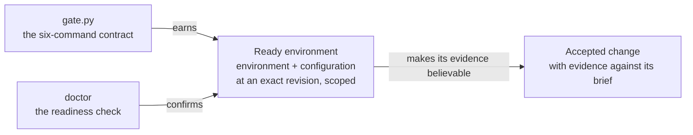
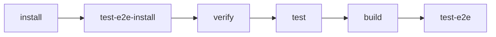
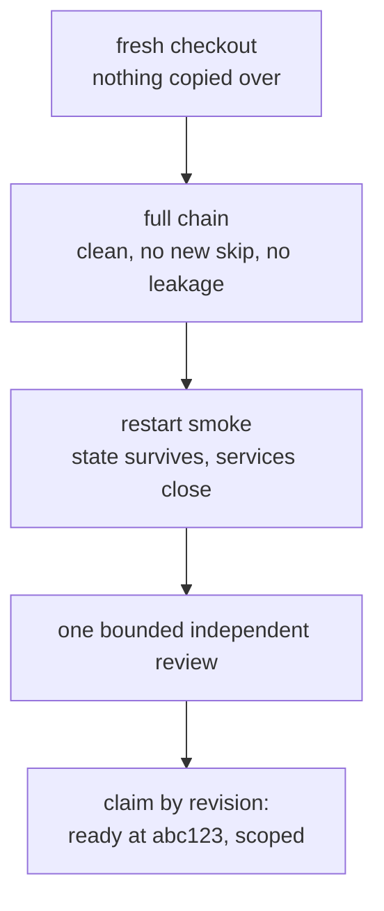
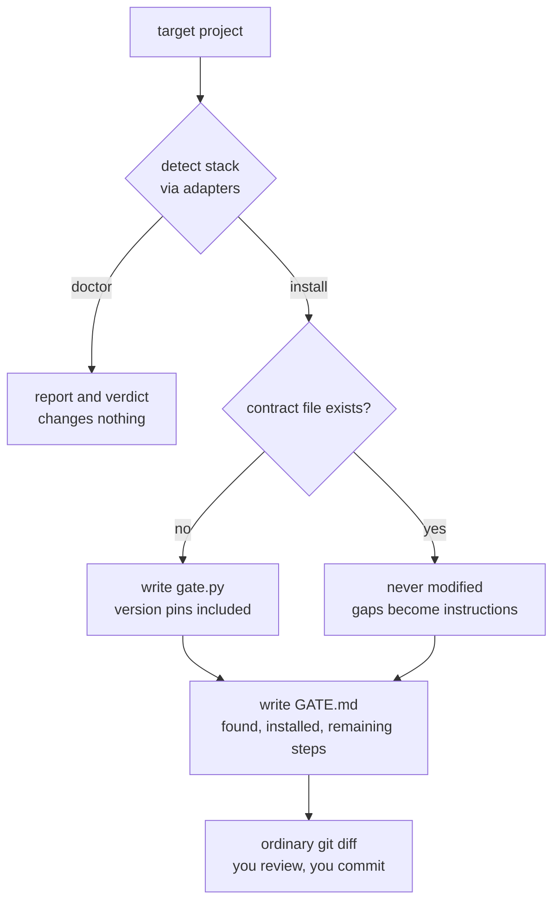
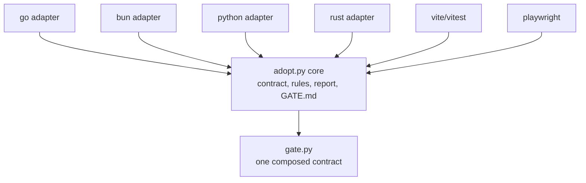

# The quality gate

Two ideas, kept separate:

- **A ready environment.** Locked deps, honest tests, isolated config, safe
  startup. When the tests pass, believe them. Claims name the environment
  and its configuration at an exact revision, for a stated scope: "ready on
  this machine, at this commit, for local development." "Ready" alone is
  not a claim. (Standards: *qualified environment*, DO-330.)
- **An accepted change.** One reviewed change, patch, revision or
  modification, with evidence it does what its brief says. Fit for purpose,
  not just compiling. (Standards: *validated candidate*, IEEE V&V.) The
  rest of this framework owns that side. Readiness comes first: evidence
  from an unready environment is worthless.

Proven on Kept, November 2026: 334 web tests, 121 of 125 browser journeys
green, restart smoke, independent review.



## Use it

Python 3.9+ is the only requirement. macOS dev tools, desktop Linux and
every GitHub runner already have it.

```bash
python3 quality-gate/doctor  /path/to/project          # readiness check; read-only
python3 quality-gate/install /path/to/project          # install safe pieces, get GATE.md
python3 quality-gate/install /path/to/project --ci     # plus optional CI workflow
```

install needs a git repo: every change is meant to be read as a `git diff`.
doctor needs nothing.

## The contract

Six commands, generated for your stack as `gate.py`:

```
python3 gate.py install            locked, frozen deps; no lifecycle scripts
python3 gate.py test-e2e-install   browser test deps
python3 gate.py verify             module integrity, clean diff, pinned versions
python3 gate.py test               the full native suite
python3 gate.py build              real production artifacts
python3 gate.py test-e2e           build once, run the browser suites
```

A Makefile, Taskfile or npm scripts with the same steps counts. The shape
is the contract, not the runner.



## The rules

Each exists because its absence caused a real defect.

- **Lockfile required.** Frozen flags don't reject a missing lockfile.
- **Isolated environment.** Explicit child env, `--no-env-file`,
  `envDir: false`, a sentinel test proving stray `.env` files can't change
  results.
- **Synthetic state only.** Never household config or provider credentials.
- **Loopback, strict ports, no server reuse.** A taken port fails the run.
- **Browser runner owns its services**, and they close afterwards.
- **Cleanup never gates tests.**
- **Safe dev startup.** Never delete the database. State survives restart.
- **No manufactured green.** No new skips, no broad excludes.

## Passing

From a fresh checkout with nothing copied over:

1. The full chain: clean, no new skip, no missing input, no leakage.
2. The restart smoke (`templates/restart-smoke.md`).
3. One bounded independent review. One. No extra rounds.

Then claim exactly what you proved, by revision: "ready at `abc123` for
local macOS development." Linux, containers, deployment, AI services:
unclaimed, non-blocking, until a feature needs them. CI is opt-in (`--ci`).



## What the tool does, and never does

Detects the stack, writes only missing files, writes `GATE.md` with your
remaining steps. Three rules always: **never overwrite, never delete, no
hidden machinery.** No transactions, journals or receipts; we built those
once and they made more work than they saved. Whatever it can't safely
automate (safe dev commands, env wiring, the smoke, the run itself) lands
in `GATE.md` as numbered instructions for you or your agent.



## Do it by hand

The tool is a convenience. Everything it does:

**doctor** notes the OS; detects toolchains by marker files (`go.mod`,
`bun.lock`/`package.json`, `pyproject.toml`/`requirements.txt`/`setup.py`/
`Pipfile`, `Cargo.toml`, `vite.config.*` beside a `package.json` in
`web/frontend/ui/app/apps/web/client` or root, `playwright*.config.*`
within three levels); reads versions; checks for `gate.py` or an equivalent
Makefile, env isolation, and whether dev startup deletes a database; prints
a verdict. Changes nothing.

**install** refuses non-git targets; generates `gate.py` from the matched
toolchains with version pins; with `--ci` writes one pinned Ubuntu
workflow; with Vite+Vitest copies the env-isolation test template; writes
`GATE.md` (what it found, what it installed, your numbered remaining
steps). Never modifies existing files. Everything shows in `git diff`.

## Extend it

The core knows the contract; adapters know toolchains. Go, Bun, Python and
Rust ship today; Vite/Vitest and Playwright compose on top. One registry
entry per stack in `adopt.py`:

```python
{"name": "mytool", "detect": detect_mytool,
 "install": ["mytool fetch --locked"], "verify": ["mytool verify"],
 "test": ["mytool test"], "build": ["mytool build --release"],
 "pin": lambda f: [...], "guidance": {"topic": "GATE.md remainder text"}}
```



## Not required yet

Historical assurance, containers, AI services, deployment, attestation,
hostile-host models: each waits until a feature needs it.

## Sources

Kept, November 2026: candidate `150b7c9`, 334 web tests, 121/125 green, 4
known skips, 0 failures, restart smoke, review PASS. Full reasoning:
`Golden-Implementation-Playbook-2026-11-11.md` and the Golden Development
Contract (2026-11-10; both predate this vocabulary, same ideas).
