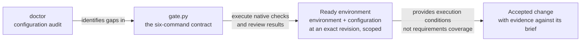
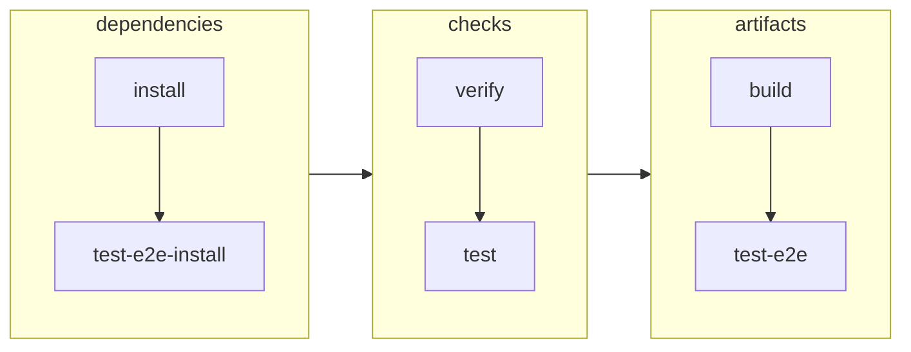
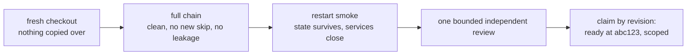
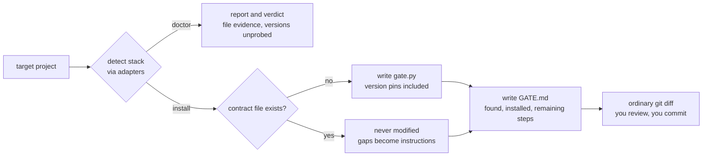
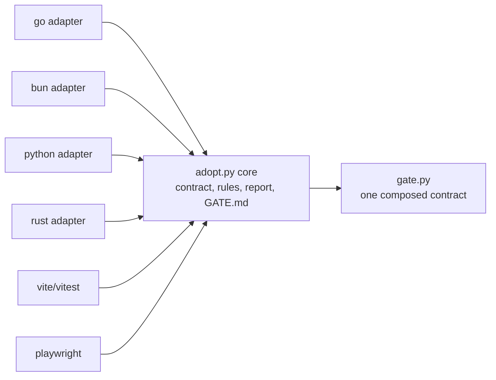

# The quality gate

Two ideas, kept separate:

- **Setup checks:** can this project reliably install dependencies, build,
  run and execute its checks in the stated environment? Record the revision,
  environment and demonstrated scope. Configuration inspection alone cannot
  establish readiness, and readiness does not establish adequate test coverage.
- **Change checks:** does this exact change meet the ticket, respect the brief
  and support the intended goal? BDD, TDD, browser journeys and review supply
  the evidence. A green existing suite does not automatically answer that question.

Kept's retained record attributes local acceptance to candidate `150b7c9`,
November 2026: 334 web tests,
121 of 125 browser tests passed, four existing skips, restart smoke and
independent review. The referenced final review and raw acceptance evidence
are missing from the current corpus, so these details remain record-attributed.
They concern Kept's local macOS setup, not acceptance of this Python generator
or every generated stack.

### Adoption-kit evidence and limits (11 November 2026)

At source revision `d06ff38`, fresh synthetic macOS fixtures for Go,
Python, Rust and Bun/Vite exercised the public `doctor` and `install`
commands. All four generated compilable `gate.py` files and `GATE.md`;
`doctor` left fixture bytes unchanged; repeated installation preserved
existing source and `gate.py` bytes. This is detection and generation
coverage, not a full adoption run.

Generated `verify` passed for the minimal Go, Python and Bun/Vite
fixtures. Rust `verify` failed because Cargo was unavailable. The Python
fixture's unsupported build and browser paths failed, and the Bun fixture
refused installation without a lockfile. No dependency installation,
full native test suite, production build, browser journey or Windows/Linux
run was accepted for these generated fixtures.

The local successor includes repairs for demonstrated defects: unknown generated
subcommands now exit 2, and Python installation requires explicit configuration
when `requirements.txt` is absent rather than guessing a package manager.
The earlier regression record covered nine tests. The independently accepted non-executing inspection candidate passed fifteen
test methods covering dispatch, Python markers and requirements, preservation,
audit file preservation, Playwright directories, Vite variants and build-failure
propagation, subprocess-forbidden audit across nine synthetic fixtures, public
doctor PATH wrappers and installation version pins. That acceptance covers file-derived inspection and preserved installation pins.
The successor added eight script-reporting tests. Its F1 repair adds four root-absence
compatibility cases and two missing-expected/unreadable boundary tests; focused
independent F1 closure passed 11/11 bounded synthetic checks. Explicit command
planning has local implementation evidence and awaits independent acceptance.
The root-level Playwright command now uses `--cwd .` rather than consuming
`playwright` as a directory argument. These are generator checks, not real browser acceptance.
Run `python3 -m unittest discover -s quality-gate -p 'test_*.py' -v`.

Remaining limits: generated tasks use shell commands and do not establish
cross-platform equivalence. `doctor` checks recognisable configuration, not
semantic correctness or readiness. Generated code is scaffolding, not a complete
environment-isolation or dependency-locking implementation. Review and adapt it;
general consumer adoption and Windows/Linux acceptance remain unproven.
Toybox's separate bounded acceptance covers owned dependencies, a cold-copy
installation and a no-recording journey, not this generator. See the
[field evidence](../research/field-lessons.md).



## Use it

The adoption tool requires Python 3.9+. Installation also requires Git;
the generated commands require the target project's native toolchains.
Check availability on the actual machine. Python availability alone is
not evidence that a generated gate works on that operating system.

```bash
python3 quality-gate/doctor  /path/to/project          # file-derived inspection; no version executables
python3 quality-gate/install /path/to/project          # install safe pieces, get GATE.md
python3 quality-gate/install /path/to/project --ci     # plus optional CI workflow
```

install needs a git repo: every change is meant to be read as a `git diff`.
doctor does not require Git or execute version tools. It reports marker evidence,
unprobed versions, unverified command defaults and unproven readiness. It reads
recognised configuration as text and does not import it. It reports package scripts
as unexecuted declarations/candidates, not verified native commands. Installation still probes available PATH tools for
version pins.

Script reporting covers root `package.json` plus the single existing frontend
selected by the fixed-directory Vite detector (root is deduplicated). Each entry
labels source manifest/path, script name, literal command and working directory
relative to the audited target. JSON escaping keeps control characters inert.
Custom script names are retained without interpreting shell text. An absent root
manifest is informational: root package-script discovery is not applicable unless
the Vite detector already identified that manifest as expected. Missing expected
manifests (including a present path disappearing before reading), present unreadable
manifests, invalid JSON/encoding, nonobject manifests or `scripts`, and
nonstring script values are unresolved discovery; valid siblings remain visible.
An absent or empty `scripts` object means no scripts declared, not malformed input.
Unresolved items contribute to reported gaps; audit exit 0 means inspection completed,
not ready. This does not scan general monorepos or choose a package manager:
`package.json` alone does not establish Bun, even when the legacy Bun adapter matches.
Generated defaults remain unverified; installation and gate generation are unchanged.

## Review the generated defaults before running them

Generate the scaffold from the same activated toolchain environment used for
acceptance. For Python, create/activate the isolated virtualenv first, then run
`install` with that environment's `python3` on PATH. Generation pins
the discovered versions; changing interpreters afterward can correctly fail
`verify`. Existing `gate.py` is preserved on rerun, not silently repinned.

The generator is a starting point, not native-runner discovery:

- Python assumes `pytest`; declare it in the project's locked development
  dependencies, or replace that command with the existing native runner (for
  example `python3 -m unittest discover -v`). Do not install a new test framework
  merely to satisfy a generated default. Review the requirements installation
  command for lock/hash and build-hook policy before any nonempty installation.
- Go build assumes `./cmd/server`; adapt to the existing application entrypoint.
- Vite uses the project's `test` script and `vite build`; `tsconfig.json` adds
  TypeScript checks. Nonstandard TypeScript configurations need an explicit
  native typecheck command. Root Vite is reported as `.`.
- Bun installation requires a real `bun.lock` produced by the project's normal
  dependency-resolution workflow. Do not fabricate one. Rust requires Cargo and
  its lockfile; missing toolchains are untested scope, not a passed path.
- Browser and persistence checks apply when the supported product scope has a
  browser or persistent service. A justified N/A for a pure command-line fixture
  does not waive those requirements for a web application.

## The contract

Six commands, generated for your stack as `gate.py`:

```
python3 gate.py install            adapter-specific dependency installation
python3 gate.py test-e2e-install   browser test deps
python3 gate.py verify             adapter checks, diff whitespace, detected version pins
python3 gate.py test               the full native suite
python3 gate.py build              real production artifacts
python3 gate.py test-e2e           build once, run the browser suites
```

A Makefile, Taskfile or npm scripts with the same steps counts. The shape
is the contract, not the runner.

Installation guarantees differ by adapter. Bun uses `--frozen-lockfile` and
`--ignore-scripts`; Rust uses `cargo fetch --locked`; Go uses `go mod download`.
Python uses `python3 -m pip install -r requirements.txt`, which alone guarantees
neither frozen resolution nor suppression of build scripts. Review each native
command and dependency policy before installation.

`verify` is not a clean-worktree or universal dependency-integrity certificate.
Its common Git check is `git diff --check`, which checks whitespace, not whether
files changed. Adapter checks differ: Go adds `go mod verify`; Bun has no
additional module-integrity command here. Only detected tool versions are pinned.
At acceptance, separately inspect `git status --short` and bind the reviewed
source to the tested commit or tree. Review the native lock/install guarantees
for the actual stack rather than inferring them from the command name.
Likewise, generated commands do not sanitize the caller environment by themselves;
use an explicit clean child environment and prove the project's isolation with
a synthetic sentinel before claiming readiness.



## The rules

Each exists because its absence caused a real defect. See the [CFA and Kept
field lessons](../research/field-lessons.md) for the source and limits.

- **Lockfile required.** Frozen flags don't reject a missing lockfile.
- **Isolated environment.** Explicit child env, `--no-env-file`,
  `envDir: false`, a sentinel test proving stray `.env` files can't change
  results.
- **Synthetic state only.** Never household config or provider credentials.
- **Loopback, strict ports, no server reuse.** A taken port fails the run.
- **Browser runner owns its services**, and they close afterwards.
- **Separate assertion and cleanup outcomes.** An optional helper cannot rewrite
  a test result; leaked services or sensitive residue still block safety acceptance.
- **Safe dev startup.** Never delete the database. State survives restart.
- **No manufactured green.** No new skips, no broad excludes.

## Passing

From a fresh checkout with nothing copied over:

1. The full chain: clean, no new skip, no missing input, no leakage.
2. The restart smoke (`templates/restart-smoke.md`).
3. One bounded independent review. Repair concrete blockers and rerun affected
   evidence without starting an open-ended review programme.

Then claim exactly what you proved, by revision: "ready at `abc123` for
local macOS development." Linux, containers, deployment, AI services:
unclaimed, non-blocking, until a feature needs them. CI is opt-in (`--ci`).



## What the tool does, and never does

Detects the stack, writes missing scaffold files, and regenerates `GATE.md`
with remaining steps. Existing `gate.py`, Makefile and isolation-test files
are preserved; **`GATE.md` is overwritten on each install**, so keep manual
notes elsewhere. No deletion, transactions, journals or receipts. Whatever
it cannot safely automate (safe dev commands, env wiring, the smoke, the
acceptance run itself) lands in `GATE.md` as numbered instructions.



## Do it by hand

The tool is a convenience. Everything it does:

**doctor** notes the OS; detects toolchains by marker files (`go.mod`,
`bun.lock`/`package.json`, `pyproject.toml`/`requirements.txt`/`setup.py`/
`Pipfile`, `Cargo.toml`, `vite.config.*` beside a `package.json` in
`web/frontend/ui/app/apps/web/client` or root, `playwright*.config.*`
within three levels); checks for `gate.py` or an equivalent Makefile and text
markers for env isolation and database deletion in dev startup; prints a verdict.
It preserves target files and executes no version tools. These heuristics do not
verify runtime isolation, safe startup or readiness.

**install** refuses non-git targets; generates `gate.py` from the matched
toolchains with version pins; with `--ci` writes one pinned Ubuntu
workflow; with Vite+Vitest copies the env-isolation test template; writes
`GATE.md` (what it found, what it installed, your numbered remaining
steps). Existing scaffold files are preserved; `GATE.md` is regenerated.
Review tracked changes with `git diff` and new files with `git status`.

## Extend it

The core knows the contract; adapters know toolchains. Go, Bun, Python and
Rust ship today; Vite/Vitest and Playwright compose on top. One registry
entry per stack in `adopt.py`:

```python
{"name": "mytool", "detect": detect_mytool,
 "install": ["mytool fetch --locked"], "verify": ["mytool verify"],
 "test": ["mytool test"], "build": ["mytool build --release"],
 "pin": lambda f: [...], "guidance": {"topic": "GATE.md remainder text"}}
```



## Not required yet

Historical assurance, containers, AI services, deployment, attestation,
hostile-host models: each waits until a feature needs it.

## Sources

Kept, November 2026: retained-record attribution for candidate `150b7c9`,
334 web tests, 121/125 browser passes, four known skips, zero failures,
restart smoke and review PASS. The referenced final review and raw evidence
are unavailable in the current corpus. See [evidence anchors and limits](../research/field-lessons.md#evidence-anchors).

## Explicit command plan

After inspecting `doctor` output and the target's documented commands, a person
or LLM supplies the same explicit arguments from the playbook checkout.

```sh
python3 quality-gate/adopt.py plan /path/to/project \
  --command test backend 'go test ./...' \
  --command test frontend 'npm run ui:check' \
  --command build frontend 'npm run bundle:ui'
```

Repeat `--command TASK DIRECTORY COMMAND` for the six existing tasks, `install`,
`test-e2e-install`, `verify`, `test`, `build`, and `test-e2e`. Repeated task commands
retain argument order. Custom script invocations remain literal supplied commands.
Provenance is explicitly supplied/unverified. Command selection requires review
of the declaration, runner and prerequisites by the person or agent.

Directories must exist relative to the target and resolve inside it. Absolute
paths, `..` traversal and outside symlinks are rejected. Ordinary inside paths,
spaces and apostrophes are supported, including directories beyond detector
coverage. A partial selection exits 0. Missing selections, invalid task/arity,
blank commands and invalid targets/directories exit 2 with a specific diagnostic.
Every selection is validated before any paste-ready snippet is printed.

The deterministic preview prints ordered adoption-map rows, remaining manual
tasks and stack roles, and Python entries for the existing generated `COMMANDS`
dict. Display values are escaped and Python literals preserve command text.
Each command runs in a directory-scoped subshell, with the whole supplied command
gated by successful directory change. Run the generated gate from the target root.
Planning leaves target bytes unchanged, reads no target gate/config as code,
and performs no command execution, version probes or Git subprocesses.

For manual application, review each selected list against the existing required
checks. The entries replace only selected `COMMANDS` lists, so merge every
required existing check into the reviewed lists before pasting. Update the
repository's authoritative adoption map and inspect the ordinary diff. For a
Makefile or other existing owner, transfer the selections into its native recipes.
Reviewed application is available through the explicit opt-in below. Execute the
ordinary `python3 gate.py test` or other selected task only with the target's authority.
Command planning supplies proposed, unexecuted selections. Native-runner inference,
automatic script matching, general application and readiness certification remain
outside this capability.

The `test_plan_*` regressions cover selection, deterministic preview, invalid inputs,
escaping, forbidden subprocesses, inert poison files and unchanged target bytes.
Owned synthetic manual application exercises the ordinary generated `gate.py test`
entrypoint, directory/order preservation, fail-first stopping and whole-command
gating after a directory disappears. These are local synthetic implementation
checks supported by bounded independent acceptance, with platform portability unproven.

### Reviewed gate application contract

The bounded implementation uses the following opt-in syntax. Review
the exact diff and `Confirmation SHA256` line from preview. Supply that value
explicitly on the second invocation, with identical target and selections.

```sh
python3 quality-gate/adopt.py plan /path/to/project --preview-gate \
  --command test . 'python3 -m unittest discover -s tests -v'
python3 quality-gate/adopt.py plan /path/to/project --apply-gate FINGERPRINT \
  --command test . 'python3 -m unittest discover -s tests -v'
```

The mode option must follow TARGET and precede all selections. Plain `plan` keeps
its read-only paste-ready behaviour. Preview reads existing `TARGET/gate.py` as
inert text with the stdlib AST. Exactly one module-level simple `COMMANDS = {...}`
assignment is supported, with unique known task-string keys and literal lists of
strings. Selected tasks must already exist. Unsupported assignments, mutations,
syntax and shapes are refused. UTF-8 source with an optional BOM is supported.
Direct COMMANDS reads are restricted to task iteration through `COMMANDS.get(...)`
or `COMMANDS[...]`. Aliases and other references require manual adaptation. This
includes additional `COMMANDS` bindings in any scope: imports, definition names,
parameters, exception targets, pattern captures and type parameters when supported
by the running parser. Wildcard imports are refused because their bound names are
unknown. `global` and `nonlocal COMMANDS` declarations are also unsupported semantic
references. Unrelated names, strings and comments remain inert. This is a bounded
source-shape check, with arbitrary target behaviour still requiring source review.
Preview creates no file and executes no target code.

The unified diff is printed as a JSON-escaped UTF-8 string so control characters
stay inert. JSON decoding recovers its exact bytes, including line endings and
missing-final-newline markers. An empty string means no proposed change.

Application appends missing exact rendered commands after existing checks in each
selected list. Existing commands, unselected tasks and surrounding bytes are kept.
Unsuitable defaults require an explicit manual decision. The SHA-256 confirmation
binds canonical target, original bytes, permission mode, ordered selections and
resulting bytes. Apply requires the preview's expected value and refuses stale
content or changed selections. Running gate tasks requires separate authority.

A changing apply exclusively creates `gate.py.reviewed-backup` containing the
original bytes and mode, and `gate.py.reviewed-tmp` containing the complete new
file. It flushes both files, rechecks original identity/content/mode immediately
before atomic replacement, and preserves permission mode. Existing backup/temp
paths cause refusal. These fixed paths bound retained recovery files. Interrupted
or failed preparation can leave these files for manual inspection and recovery.
Keep or relocate the backup before another changing apply. No recovery file is
automatically deleted. A fresh preview after application yields an empty diff,
and confirmed no-change apply writes nothing, even with the retained backup.
Reusing the old fingerprint after a changing apply refuses.

The supported workflow has one implementation writer. Final rechecking handles
ordinary stale edits. Arbitrary hostile concurrent writers and every filesystem
race remain outside the guarantee. Local Python/macOS synthetic evidence is the
admission boundary. General installer behaviour, runner inference, execution and
readiness certification require separate work and evidence.

The `test_reviewed_*` regressions exercise this opt-in capability with synthetic local
fixtures. They cover byte/mode preservation, native unittest execution and failure
propagation, confirmation and stale-edit refusal, AST shapes and decoys, bounded
recovery, injected pre-replacement failure, exact diffs and idempotence. The complete
owning suite passed 49 tests. Bounded independent source review and binding-refusal
closure passed. A fresh blind consumer used public documentation to preserve its
required check, add two native tests, expose a deliberate failure, restore them and
make a second reviewed update. Its public product copy stayed unchanged. Command
selection, JSON-diff inspection and backup relocation remained manual friction.
These are local synthetic observations, not general consumer or platform readiness.
The existing read-only plan tests remain in place.
