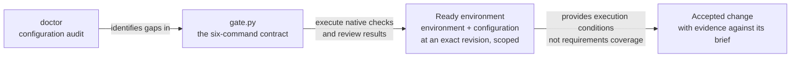
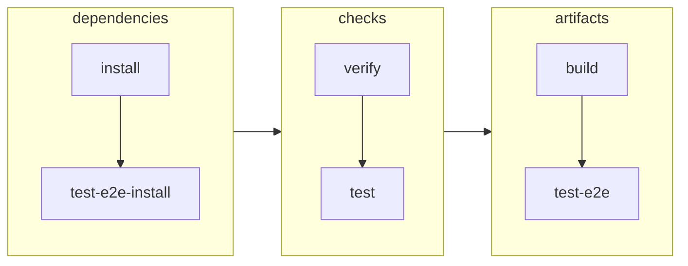
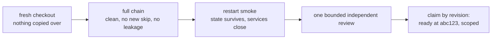
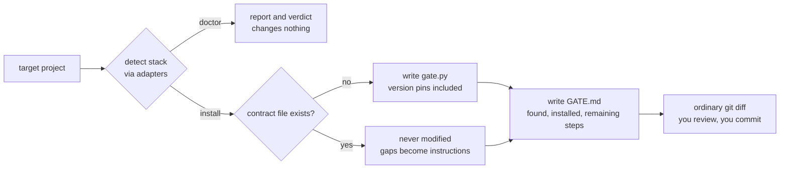
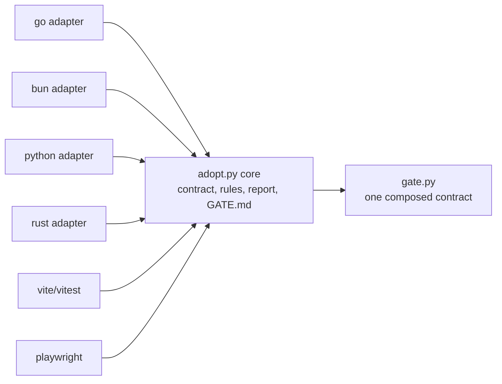

# The quality gate

Two ideas, kept separate:

- **Setup checks:** can this project reliably install dependencies, build,
  run and execute its checks in the stated environment? Record the revision,
  environment and demonstrated scope. Configuration inspection alone cannot
  establish readiness, and readiness does not establish adequate test coverage.
- **Change checks:** does this exact change meet the ticket, respect the brief
  and support the intended goal? BDD, TDD, browser journeys and review supply
  the evidence. A green existing suite does not automatically answer that question.

The native contract was accepted on Kept, November 2026: 334 web tests,
121 of 125 browser tests passed, four existing skips, restart smoke and
independent review. That is evidence for Kept's local macOS setup, not
acceptance of this Python generator or every generated stack.

### Adoption-kit evidence and limits (11 November 2026)

At source revision `d06ff38`, fresh synthetic macOS fixtures for Go,
Python, Rust and Bun/Vite exercised the public `doctor` and `install`
commands. All four generated compilable `gate.py` files and `GATE.md`;
`doctor` left fixture bytes unchanged; repeated installation preserved
existing source and `gate.py` bytes. This is detection and generation
coverage, not a full adoption run.

Generated `verify` passed for the minimal Go, Python and Bun/Vite
fixtures. Rust `verify` failed because Cargo was unavailable. The Python
fixture's unsupported build and browser paths failed, and the Bun fixture
refused installation without a lockfile. No dependency installation,
full native test suite, production build, browser journey or Windows/Linux
run was accepted for these generated fixtures.

The local successor includes repairs for demonstrated defects: unknown generated
subcommands now exit 2, and Python installation requires explicit configuration
when `requirements.txt` is absent rather than guessing a package manager.
Nine standard-library regression tests exercise dispatch, each Python marker,
the existing requirements route, repeat-install preservation, read-only audit,
root/nested Playwright working directories and build-failure propagation.
The root-level Playwright command now uses `--cwd .` rather than consuming
`playwright` as a directory argument. These are generator checks, not real browser acceptance.
Run `python3 -m unittest discover -s quality-gate -p 'test_*.py' -v`.

Remaining limits: generated tasks use shell commands and do not establish
cross-platform equivalence. `doctor` checks recognisable configuration, not
semantic correctness or readiness. Generated code is scaffolding, not a complete
environment-isolation or dependency-locking implementation. Review and adapt it;
consumer installation and Windows/Linux acceptance remain unproven.



## Use it

The adoption tool requires Python 3.9+. Installation also requires Git;
the generated commands require the target project's native toolchains.
Check availability on the actual machine. Python availability alone is
not evidence that a generated gate works on that operating system.

```bash
python3 quality-gate/doctor  /path/to/project          # configuration audit; read-only
python3 quality-gate/install /path/to/project          # install safe pieces, get GATE.md
python3 quality-gate/install /path/to/project --ci     # plus optional CI workflow
```

install needs a git repo: every change is meant to be read as a `git diff`.
doctor needs nothing.

## The contract

Six commands, generated for your stack as `gate.py`:

```
python3 gate.py install            locked, frozen deps; no lifecycle scripts
python3 gate.py test-e2e-install   browser test deps
python3 gate.py verify             module integrity, clean diff, pinned versions
python3 gate.py test               the full native suite
python3 gate.py build              real production artifacts
python3 gate.py test-e2e           build once, run the browser suites
```

A Makefile, Taskfile or npm scripts with the same steps counts. The shape
is the contract, not the runner.



## The rules

Each exists because its absence caused a real defect. See the [CFA and Kept
field lessons](../research/field-lessons.md) for the source and limits.

- **Lockfile required.** Frozen flags don't reject a missing lockfile.
- **Isolated environment.** Explicit child env, `--no-env-file`,
  `envDir: false`, a sentinel test proving stray `.env` files can't change
  results.
- **Synthetic state only.** Never household config or provider credentials.
- **Loopback, strict ports, no server reuse.** A taken port fails the run.
- **Browser runner owns its services**, and they close afterwards.
- **Separate assertion and cleanup outcomes.** An optional helper cannot rewrite
  a test result; leaked services or sensitive residue still block safety acceptance.
- **Safe dev startup.** Never delete the database. State survives restart.
- **No manufactured green.** No new skips, no broad excludes.

## Passing

From a fresh checkout with nothing copied over:

1. The full chain: clean, no new skip, no missing input, no leakage.
2. The restart smoke (`templates/restart-smoke.md`).
3. One bounded independent review. One. No extra rounds.

Then claim exactly what you proved, by revision: "ready at `abc123` for
local macOS development." Linux, containers, deployment, AI services:
unclaimed, non-blocking, until a feature needs them. CI is opt-in (`--ci`).



## What the tool does, and never does

Detects the stack, writes missing scaffold files, and regenerates `GATE.md`
with remaining steps. Existing `gate.py`, Makefile and isolation-test files
are preserved; **`GATE.md` is overwritten on each install**, so keep manual
notes elsewhere. No deletion, transactions, journals or receipts. Whatever
it cannot safely automate (safe dev commands, env wiring, the smoke, the
acceptance run itself) lands in `GATE.md` as numbered instructions.



## Do it by hand

The tool is a convenience. Everything it does:

**doctor** notes the OS; detects toolchains by marker files (`go.mod`,
`bun.lock`/`package.json`, `pyproject.toml`/`requirements.txt`/`setup.py`/
`Pipfile`, `Cargo.toml`, `vite.config.*` beside a `package.json` in
`web/frontend/ui/app/apps/web/client` or root, `playwright*.config.*`
within three levels); reads versions; checks for `gate.py` or an equivalent
Makefile, env isolation, and whether dev startup deletes a database; prints
a verdict. Changes nothing.

**install** refuses non-git targets; generates `gate.py` from the matched
toolchains with version pins; with `--ci` writes one pinned Ubuntu
workflow; with Vite+Vitest copies the env-isolation test template; writes
`GATE.md` (what it found, what it installed, your numbered remaining
steps). Existing scaffold files are preserved; `GATE.md` is regenerated.
Review tracked changes with `git diff` and new files with `git status`.

## Extend it

The core knows the contract; adapters know toolchains. Go, Bun, Python and
Rust ship today; Vite/Vitest and Playwright compose on top. One registry
entry per stack in `adopt.py`:

```python
{"name": "mytool", "detect": detect_mytool,
 "install": ["mytool fetch --locked"], "verify": ["mytool verify"],
 "test": ["mytool test"], "build": ["mytool build --release"],
 "pin": lambda f: [...], "guidance": {"topic": "GATE.md remainder text"}}
```



## Not required yet

Historical assurance, containers, AI services, deployment, attestation,
hostile-host models: each waits until a feature needs it.

## Sources

Kept, November 2026: candidate `150b7c9`, 334 web tests, 121/125 green, 4
known skips, 0 failures, restart smoke, review PASS. Full reasoning:
`Golden-Implementation-Playbook-2026-11-11.md` and the Golden Development
Contract (2026-11-10; both predate this vocabulary, same ideas).
