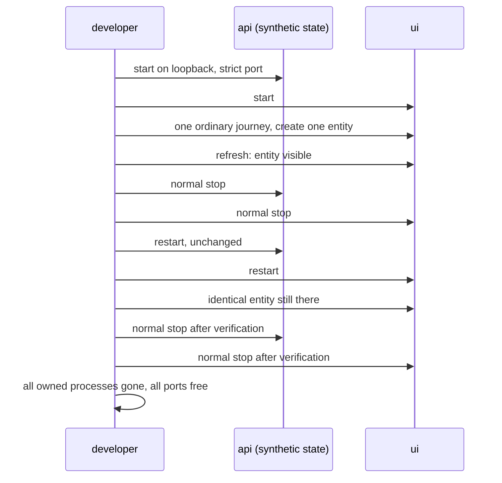

# The start/restart persistence smoke

The smoke proves the ordinary developer path is safe: synthetic state survives
a normal stop and restart, and everything the project starts also closes.
It is a bounded development smoke, not another browser-suite programme.

## What to build

One script (any language the project already uses) that:

1. Starts the documented development services (`make api` / `make ui`, or the
   project's equivalents) against **synthetic state only**: a dedicated
   synthetic database and runtime directories, loopback binding, no provider
   credentials, no household configuration.
2. Exercises **one ordinary journey**: first-run setup or a single create,
   through the real UI or API. One entity is enough.
3. Refreshes and confirms the entity is visible.
4. Stops the services normally (SIGINT/SIGTERM, not kill -9).
5. Restarts them unchanged and confirms the **identical** persisted entity.
6. Stops the restarted services normally, then confirms every owned process has exited and every owned port is free.

## Rules (each one comes from a real defect)

- The smoke must fail if a required port was already occupied. Never take over
  a foreign service.
- Startup must never delete the local database.
- Report assertion and cleanup outcomes separately. An optional file-cleanup
  helper cannot change which assertions passed. Leaked owned services, occupied
  ports or sensitive residue still fail the safety criterion and prevent full
  acceptance. Preserve the original failure if cleanup also fails.
- Use a headless browser for the UI journey if the project already has
  Playwright; otherwise exercise the API directly. Do not add a browser
  dependency just for this.
- Keep the script under the project's normal tooling so a developer can run
  it by hand. It is evidence, not a gate runner.
- Record which entity and fields survived restart. One passing seam does not
  establish persistence for every product entity. Preserve failure artifacts
  using safe, bounded paths; do not remove user data to make the run look clean.

## Reference implementation

Kept's smoke (November 2026) created a synthetic first-run owner through the
real UI, restarted the services, and verified the identical owner persisted
with zero page errors and complete port/process closure. That passed the
independent review. The shape is what matters; copy the idea, not the files.
