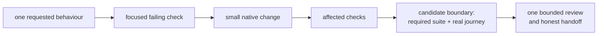

# What CFA and Kept taught us

Field experience, not a controlled comparison. These lessons come from retained reviews and exact Git candidates, not fresh product reruns. Apply the useful behaviour; do not copy each project's machinery or borrow its acceptance.

## Keep the wins

### Native commands before framework machinery

Kept's reduced local candidate `150b7c9` retained native Go checks, production TypeScript/build, all four browser suites and safe startup. Its independent review recorded 334 web tests and 125 browser tests discovered: 121 passed, four existing skips, no failures. Historical assurance and custom source/installer protocols were no longer prerequisites for ordinary development.

**Framework rule:** make install, test and build work through the project's own tools. Keep a valid existing runner. A new wrapper must close a demonstrated gap, not create another source inventory, receipt format or progress database. Removing a proof-only subsystem is an explicit scope change; it is not permission to hide product failures.

### Exercise the real boundary

CFA's runtime successor `c73a1ec` fixed failures in actual browser canaries: a Set passed to the wrong matcher, a stale national-data prerequisite outside the Dallas-local scope, a route that missed query parameters, an oversized stored error summary and a callback that had never been reached. Earlier broad passes did not establish those runtime claims.

**Framework rule:** run one representative real journey through the changed boundary. Check persisted/read-back results where relevant. If the failure is in the harness, repair its incorrect assumption without weakening the product assertion. Use the real scoped input, not fabricated replacement data.

### Build what the browser actually uses

Kept's production typecheck exposed compilation debt that narrower checks had not closed. CFA's static-data canary depended on the correct release dataset and byte parity.

**Framework rule:** build the real production target before browser acceptance; test that build, not a stale dev server or copied output. Record the native build command and artifact location. A failed build stops the browser step. Generated commands need the correct working directory even when configuration lives at repository root.

### Isolate the actual worker, not only its configuration

Kept's audit distinguished Vite's env-file handling, Bun's process arguments and the environment of the test worker itself. Configuration text alone did not establish isolation.

**Framework rule:** plant synthetic parent and env-file sentinels, launch through the ordinary test command, then inspect the actual worker. Check the intended runtime and a deliberately failing assertion's nonzero exit. Unadapted templates and `expect(true).toBe(true)` are not that evidence. Never use real credentials as probes.

### Preserve state, then prove closure

Kept's final smoke created a synthetic owner through the UI, refreshed, stopped normally, restarted and observed the same owner. It also checked that owned processes closed. That establishes this seam, not persistence of every entity.

**Framework rule:** test the documented developer startup, not a special safe substitute. Use persistent synthetic paths, strict loopback ports, one entity and normal restart. A busy port must fail; never replace a foreign service.

## Correct the wording that could hide failures

**Assertion outcome and cleanup outcome are separate.** An optional file-cleanup utility must not rewrite a test result. However, a leaked owned service, occupied port or exposed sensitive file is an unresolved safety criterion and prevents full acceptance. Preserve the original failure and separately report cleanup failure; never turn either into a pass.

CFA's bounded cleanup repair `a9a03e1` addressed generated test/lifecycle residue without treating user files as disposable. Reuse the ownership/path checks relevant to the target. This playbook does not grant permanent-deletion or service-lifecycle authority.

**Counts describe different things.** Record discovered, passed, failed and skipped tests by suite, with skip reasons. Do not sum overlapping focused and broad suites into an inflated total. Zero discovered tests and focused-only selection are not acceptable substitutes for the intended suite. A completed process, generated report or green summary is not proof that a required journey executed.

## Keep the workflow small

CFA's behaviour-preserving UI extraction `4536fdc` moved coherent map responsibilities and updated the source map rather than splitting files arbitrarily. Kept's audit showed that duplicated manifests, historical admission gates and repeated broad proof rounds could dominate the work they were intended to support.

Use this cycle:

Keep related code together; refactor only when a responsibility or observed defect justifies it. Run affected checks while editing and broad required checks at the candidate boundary. One bounded review does not waive a concrete blocking finding; fix it and rerun affected evidence, without inventing another programme.

Local macOS acceptance does not establish Linux, deployment, real AI services or hostile-code authenticity. Kept's final scope explicitly excluded hosted CI. Telemetry deployment remains unimplemented; its current local-default hosting choice is in [DIAGNOSTICS.md](../DIAGNOSTICS.md). These boundaries cannot block unrelated native work unless the requested behaviour actually depends on them.

## Transfer into the framework

- [Adoption](../ADOPT.md): inspect and reuse before adding tools.
- [Setup checklist](../checklists/quality-gate.md): real commands, worker isolation, coverage and lifecycle evidence.
- [Restart smoke](../quality-gate/templates/restart-smoke.md): state persistence and separate cleanup outcome.
- [Verification record](../templates/VERIFICATION.md): build/runtime identity, native suite counts and limits.
- Python generator regressions: `python3 -m unittest discover -s quality-gate -p 'test_*.py' -v`.

The generator remains scaffolding. Its tests do not certify every generated stack, isolation template or consumer installation. Toybox is the planned cold-consumer validation, not an already accepted installation.

## Evidence anchors

- **Kept final independent review, 11 November 2026:** exact candidate `150b7c9f9b200497c319f68dd8b8dfedb186defe`, local macOS only. Scope, native checks, suite counts, state persistence and process closure were read from that retained review.
- **Kept direction audit, 11 November 2026:** sections on justified repairs, excessive machinery and native replacement. Its earlier Ubuntu proposal was superseded by the final local-only acceptance; do not reintroduce it.
- **CFA `c73a1ecdcb10dc83bdb20e1baddcbac067c7999c`:** `definitions/runtime-canary-successor-contract.md`, read from the committed source. Describes the observed failures and bounded repair, not a new runtime rerun here.
- **CFA `a9a03e1a36fced718d6ebabe00f87cf1f22d02e6`:** generated-temp cleanup repair; committed changed-path inventory inspected and retained acceptance used for the outcome.
- **CFA `4536fdcc3738582ecaa73736f83a7bb0f264a6fc`:** map-responsibility extraction and source-map update; committed changed-path inventory inspected and retained acceptance used for the outcome.

These are project-specific observations and resulting engineering choices, not evidence that the complete framework is universally superior. Private retained evidence is not bundled into the public playbook.
