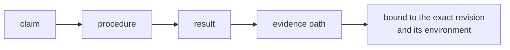
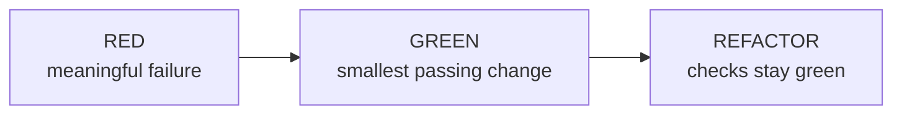

# Verification, validation, and evidence record

Use the project-native identity for the change, artefact, or release being evaluated.

Verification checks specified requirements. Validation checks intended use and stakeholder expectations. Testing, inspection, analysis, and demonstration can support either purpose.

## Subject

- **Candidate or artefact:** `<commit, version, release artefact, or other project-native identity>`
- **Affected requirements:** `<IDs>`
- **BDD journeys:** `<IDs>`
- **Applicable authorities:** `<requirements, standards, policies, contracts, schemas, or owners>`
- **Build consumed:** `<native build command, artifact path, revision and whether produced in this run>`
- **Execution scope:** `<OS/runtime and synthetic fixture identity; explicitly unclaimed platforms/services>`

## Change acceptance: ticket, brief and goal

Evaluate one exact candidate. Do not substitute environment readiness, a green existing suite or verified provenance for evidence that the request was met.

- **Ticket and version:** `<authoritative request and acceptance criteria>`
- **Brief and version:** `<relevant purpose, users, constraints and non-goals>`
- **Goal:** `<intended user outcome and this change's expected contribution>`
- **Scope:** `<included behaviour, exclusions and relevant regression risks>`

| Claim ID | Ticket criterion, brief clause or goal claim | Observable expected result | Check and evidence at candidate revision | Supported / failed / unproven |
|---|---|---|---|---|
| A-001 | `<source and exact criterion>` | `<observable condition>` | `<procedure, actual result, evidence path and revision>` | `<status>` |

Cover every ticket acceptance criterion and each relevant brief constraint. Demonstrate the affected user task. Separate observed task success from an anticipated business or user outcome that requires later measurement.

- **Conflicts or ambiguity:** `<ticket/brief conflict and responsible decision owner, or none>`
- **Deferred outcome measurement:** `<measure, owner and when it can be assessed, or none>`
- **Explicit exceptions or scope changes:** `<authority, rationale and affected claim IDs, or none>`

Missing evidence is **unproven**, not supported. A conflict cannot be resolved by silently rewriting the requirement. Acceptance requires support for all required claims or an explicit authorised change/exception; deferred outcomes remain unproven.

## Stack map

| Role | Tool or practice used | Version or identity | Substitution or N/A reason |
|---|---|---|---|
| runtime and fast tests | `<value>` | `<value>` | `<value>` |
| browser journeys | `<value>` | `<value>` | `<value>` |
| bounded UX review | `<value>` | `<value>` | `<value>` |
| error capture and recovery | `<value>` | `<value>` | `<value>` |
| supply-chain checks | `<value>` | `<value>` | `<value>` |

## Evidence

| ID | Requirement or claim | Purpose | Owner | Procedure or command | Expected result | Observed result | Evidence |
|---|---|---|---|---|---|---|---|
| V-001 | `<claim>` | `<verification, validation, or advisory observation>` | `<test layer, reviewer, or authority>` | `<procedure>` | `<condition>` | `<result>` | `<path, report, observation, or record>` |

Each final-result artefact identifies the evaluated revision and relevant environment directly or links to a run record that does. Further modifications invalidate affected final evidence.

For each required suite, retain native discovered/passed/failed/skipped counts and reasons for skips. Report overlapping focused and broad suites separately, not as one inflated total. Confirm the intended suite actually ran. Keep native logs and failure artifacts; do not create a second receipt protocol merely to restate them.

## TDD record

- **RED revision:** `<preimplementation identity>`
- **RED:** `<check and meaningful failure, or characterisation exception>`
- **GREEN revision:** `<final revision identity>`
- **GREEN:** `<check and result>`
- **REFACTOR:** `<cleanup and recheck, or none>`

## Playwright

- journeys: `<IDs or N/A>`
- command: `<command>`
- result: `<result and report>`
- production build and fixture actually used: `<identity>`
- first-failure artifacts: `<native trace/screenshot/report paths or explicit gap; retry-only capture is insufficient when retries are zero>`
- owned services closed: `<evidence or unresolved safety failure>`

## Midscene

- status: validated release evidence | advisory | N/A
- tool, model, prompt, and fixture identity: `<values>`
- bounded questions: `<questions>`
- observations: `<visible facts>`
- validation record: `<path or N/A>`
- human-labelled sample, agreement criteria, and observed result: `<values or N/A>`
- responsible approver: `<value or N/A>`
- responsible human disposition: `<accepted, rejected, unresolved, or N/A>`

Select `validated release evidence` only when the linked validation record covers the exact configuration and its criteria passed. Otherwise use `advisory`.

## Diagnostics and recovery exercise

- collection schema and field allowlist: `<version and path>`
- first-run disclosure before collection: `<evidence>`
- `OTEL_SDK_DISABLED=true` and `DO_NOT_TRACK=1`: `<independent no-file/no-network results>`
- persisted off setting and upgrade behaviour: `<result>`
- provider destination, retention and dedicated key limits: `<verified settings or not activated; no key values>`
- local report versus transmitted content: `<comparison evidence>`
- offline, expired-key and size-cap behaviour: `<results>`

- isolation: `<project or instance>`
- synthetic condition or event: `<value>`
- expected destination: `<value>`
- sensitive-field check: `<result>`
- user-visible behaviour and retained state: `<result>`
- recovery and cleanup: `<result>`
- assertion result versus cleanup result: `<separate outcomes; neither masks the other>`

## Supply chain

- resolved graph or lockfile: `<identity>`
- audit command and result: `<value>`
- audit-skipped scoped registries: `<values or none>`
- release-age policy, new-resolution applicability, exemptions, and result: `<value or N/A>`
- accepted exceptions and owner: `<value or none>`

## Evidence limits

- `<excluded condition, unresolved contradiction, uncertainty, or method limit>`

## Result

- **Supported claims:** `<IDs or none>`
- **Unresolved claims:** `<IDs or none>`
- **Review status:** `<project-native status>`
- **Responsible owner and next action:** `<value or none>`
